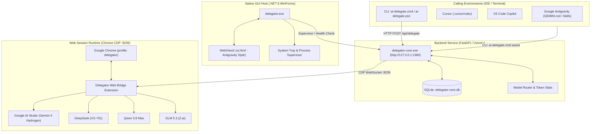

# Delegator (Antigravity Edition)

[](https://dotnet.microsoft.com/)
[](https://developer.microsoft.com/en-us/microsoft-edge/webview2/)
[](https://chromedevtools.github.io/devtools-protocol/)
[](LICENSE)

High-performance IDE delegation tool connecting developer environments (**Google Antigravity, Cursor, VS Code**) to frontier external reasoning models via isolated Chrome DevTools Protocol (CDP) web sessions — **with zero API keys required**.

Redesigned with a native **C# (.NET 8 + WebView2)** client matching Google Antigravity's minimalist dark design, integrated with **Google AI Studio (Gemini 4 Hydrogen)**, **DeepSeek**, **Qwen 3.8 Max**, and **GLM 5.3**.

---

## Key Features

- **Zero API Costs & Keyless**: Interacts directly with authenticated web sessions in a dedicated Chrome profile (`127.0.0.1:9239`), preserving free-tier web access and large token windows.
- **Antigravity 2.0 Aesthetic**: 
  - Ultra-dark theme (`#070709` background, `#0B0B0E` surface containers, `#2F71E3` accent, `rgba(255, 255, 255, 0.06)` borders).
  - Custom borderless titlebar (`FormBorderStyle = None`) with Win32 draggable header (`WM_NCLBUTTONDOWN`) and custom min/max/close controls.
  - Google Sans & JetBrains Mono typography, status indicators (`● Авторизован`), and clean toggle switches.
- **Gemini 4 Hydrogen (AI Studio)**:
  - Configured with `Thinking level: High` for maximum reasoning depth.
  - Native file dock context offloading (`-ContextFile`) and support for up to 1M token contexts.
  - Multi-turn session persistence via `-SessionId`.
- **Strict Mode Direct Targeting**:
  - Directly invoke individual models: `hydrogen` (or `argon`), `deepseek`, `qwen`, `glm`.
  - Guarantees strict execution without silent fallback if the chosen model is unavailable or rate-limited.
- **Universal Large-Text Offload**:
  - Automatically offloads prompts longer than 15,000 characters into a `00_PROMPT_PAYLOAD.txt` attachment via DataTransfer API on web file inputs.
- **Cognitive Thought Separation**:
  - Captures and exports both `[THOUGHTS]` and `[RESPONSE]` across all web models, allowing coding agents to evaluate internal reasoning before executing code.
- **Multi-Model Council (`boost`)**:
  - Runs parallel consensus across two top-tier models and combines their solutions using a judge model.

---

## Architecture



---

## Repository Structure

```
Delegator/
├── gui/                                # C# .NET 8 WinForms + WebView2 GUI
│   ├── Program.cs                      # Entry point, process supervisor, tray icon
│   ├── Backend.cs                      # WinForms <-> JS bridge, DPAPI, IDE hooks
│   ├── ui.html                         # Antigravity-style responsive dark UI
│   ├── Delegator.csproj                # Project definition (net8.0-windows)
│   └── delegator.ico                   # Application icon
├── runtime/                            # CLI runners & agent execution scripts
│   ├── ai-delegate.cmd                 # Universal CMD entrypoint
│   ├── ai-delegate.ps1                 # Core PowerShell runner (strict mode, file offload)
│   ├── ensure-web-bridge.ps1           # CDP background Chrome supervisor
│   ├── model-ratings.json              # Model rankings and capabilities
│   └── argon/                          # AI Studio CDP automation engine
│       ├── engine.js                   # Puppeteer/CDP engine for Gemini 4 Hydrogen
│       ├── ask-argon-cli.js            # Node CLI wrapper
│       └── package.json
├── extensions/
│   └── gemini-web-bridge/              # Chrome browser extension
│       ├── background.js               # Service worker routing tasks to web doors
│       ├── door.js                     # Content script automation for AI web interfaces
│       └── manifest.json               # Manifest V3 configuration
├── delegator_core/                     # Python FastAPI backend core
│   ├── main.py                         # REST API server
│   ├── router.py                       # Task router
│   ├── session_store.py                # Session management
│   └── config.py
├── integrations/
│   └── antigravity/                    # Antigravity 2.0 instructions and skill
│       ├── GEMINI_DIRECTIVES.md        # Directives for ~/.gemini/GEMINI.md
│       └── SKILL.md                    # argon-reasoning skill definition
├── docs/
│   ├── PROJECT_CONTEXT.md              # Full engineering context & release history
│   └── ARCHITECTURE.md                 # Architectural design record
├── pyproject.toml                      # Python dependency specification
├── run_server.py                       # Backend server launcher
├── LICENSE                             # License terms
└── README.md
```

---

## Getting Started

### Prerequisites

1. **Windows 10 / 11 (x64)**
2. **[.NET 8.0 SDK](https://dotnet.microsoft.com/download/dotnet/8.0)**
3. **[Google Chrome](https://www.google.com/chrome/)** (installed at standard path)
4. **[Python 3.10+](https://www.python.org/)** (for building/running core from source)

### Building the GUI

```powershell
cd gui
dotnet restore
dotnet publish -c Release -o publish
```

The output in `gui/publish/` contains `delegator.exe` and its dependencies.

### Running Backend Core

```powershell
pip install -e .
python run_server.py
```

Core listens on `http://127.0.0.1:1380`.

---

## CLI Usage

### 1. Direct Target: Gemini 4 Hydrogen (Google AI Studio)
```powershell
& ".\runtime\ai-delegate.cmd" hydrogen `
  -Prompt "Analyze this AST and find concurrency deadlocks" `
  -ContextFile "C:\path\to\file1.cs;C:\path\to\file2.cs" `
  -SessionId "deadlock-investigation"
```

### 2. Direct Target: Specific Web Models (Strict Mode)
```powershell
# DeepSeek (code analysis, algorithmic proofs)
& ".\runtime\ai-delegate.cmd" ask -Model deepseek -Prompt "Optimize this kernel algorithm"

# Qwen 3.8 Max (complex math, combinatorics)
& ".\runtime\ai-delegate.cmd" ask -Model qwen -Prompt "Compute closed-form generating function"

# GLM 5.3 (rapid parallel synthesis)
& ".\runtime\ai-delegate.cmd" ask -Model glm -Prompt "Convert this schema to Protobuf v3"
```

### 3. Multi-Model Council (`boost`)
```powershell
& ".\runtime\ai-delegate.cmd" boost -Prompt "Design fault-tolerant event sourcing architecture"
```

---

## Integration with Coding Assistants

### Google Antigravity
Copy the instructions from `integrations/antigravity/GEMINI_DIRECTIVES.md` into your `~/.gemini/GEMINI.md`. Antigravity will automatically offload complex tasks (>15k chars, stubborn bug fixes, heavy math) to Delegator and ingest model thoughts.

### Cursor / VS Code
Enable hooks via the **IDE Хуки** tab in Delegator GUI or use `runtime/cursor-hook.cmd`.

---

## Credits & License

- Original core concept and backend architecture by [confeden](https://github.com/confeden/Delegator).
- Modernized .NET 8 WebView2 Antigravity UI, Gemini 4 Hydrogen integration, strict-mode routing, and universal context offloading by [Aldiyuar](https://github.com/Aldiyuar).
- Released under the [Delegator Non-Commercial, No-AI-Training License (DNC-NAT)](LICENSE).
