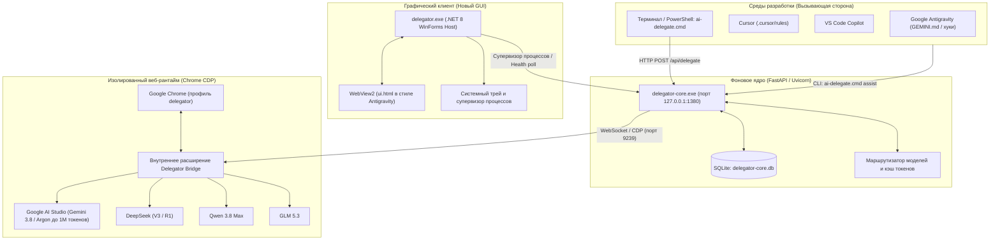

# Delegator: Полный контекст проекта, архитектура и статус разработки

> **Инструкция для нового чата**: Этот документ содержит исчерпывающее описание проекта **Delegator**, историю трёх сессий разработки, архитектуру, все пути к файлам и компонентам, решённые баги и следующие шаги. Скопируйте путь к этому файлу или передайте его агенту в начале диалога.

---

## 1. Концепция и цель проекта

**Delegator** — инструмент для прозрачного делегирования сложных инженерных задач (архитектура, написание чистого кода, глубокий рефакторинг, сложная математика) из IDE (**Google Antigravity, Cursor, VS Code, Codex**) во внешние передовые нейросети.

### Ключевые принципы решения:
1. **Zero API Keys (Работа без платных API)**: Взаимодействие осуществляется напрямую через веб-интерфейсы моделей с использованием авторизованного локального профиля Google Chrome (`chrome-profile`) в фоновом режиме через Chrome DevTools Protocol (CDP, порт `9239`).
2. **Слияние с `gemini-argon-bridge`**: В Delegator полностью интегрированы механизмы работы с сессиями, контекстными файлами (`>120 KB`), системными инструкциями и раздельным парсингом цепочки рассуждений (`[ARGON_THOUGHTS]`) и финального ответа (`[ARGON_RESPONSE]`).
3. **Нативный интерфейс в стиле Antigravity**: Оригинальный GUI на Rust (`egui`) полностью заменён на легковесную, эстетичную оболочку на C# (.NET 8 + встроенный в Windows WebView2), идеально повторяющую тёмный минималистичный дизайн Antigravity (`#0A0A0A`, карточки `#141414`, акценты `#222222`, зелёные статусные бейджи `#10B981`).

---

## 2. Архитектура системы



---

## 3. Все пути к папкам и ключевым файлам

### 3.1. Установленное приложение (Рабочий каталог рантайма)
* **Папка:** `%LOCALAPPDATA%\Programs\Delegator\`
  - `delegator.exe` — запущенный бинарник нового интерфейса (.NET 8 + WebView2).
  - `delegator.original.exe` — резервная копия оригинального Rust GUI.
  - `delegator-core.exe` — фоновый сервис ядра (FastAPI/Uvicorn, слушает `http://127.0.0.1:1380`).
  - `runtime\` — командные файлы интеграции с IDE:
    * `ai-delegate.cmd` — универсальный CLI-раннер для вызова из терминала и хуков IDE.
    * `ai-delegate.ps1` — PowerShell-скрипт делегирования с поддержкой аргументов `-CallerModel`, `-Prompt`, `-ContextFile`.
    * `ensure-web-bridge.ps1` — скрипт проверки и запуска Chrome в режиме CDP.

### 3.2. Исходный код нового интерфейса (.NET 8 GUI)
* **Папка:** `gui/` (в репозитории проекта)
  - `Delegator.csproj` — проект .NET 8 (`net8.0-windows`, `Microsoft.Web.WebView2` v1.0.4314.35).
  - `ui.html` — единый HTML/CSS/JS интерфейс (стиль Antigravity, 4 карточки веб-моделей, вкладки "Веб-модели", "IDE Хуки", "Мышление", "Статистика").
  - `Program.cs` — точка входа WinForms, управление WebView2, супервизор `delegator-core.exe` (автозапуск и корректное перенаправление stdio), трей.
  - `Backend.cs` — мост между JS и C#, чтение/запись `config.json`, DPAPI-шифрование, детекция и установка хуков в Antigravity, Cursor, VS Code.
  - `publish\` — готовая релизная сборка для развёртывания.

### 3.3. Данные пользователя, профиль браузера и база данных
* **Авторизованный профиль браузера:** `%LOCALAPPDATA%\Delegator\chrome-profile\`
  *(Внимание: здесь хранятся все активные сессии и куки. Все 4 аккаунта авторизованы, удалять или перезаписывать эту папку нельзя!)*
* **Конфигурация:** `%APPDATA%\Delegator\DelegatorWin\config\config.json`.
* **База данных и логи:** `%LOCALAPPDATA%\DelegatorWin\core\`
  - `delegator-core.db` — SQLite база данных истории запросов и кэша.
  - `delegator-core.log` — журнал работы бэкенда.
* **Рантайм-кэш и временные файлы:** `%LOCALAPPDATA%\DelegatorWin\runtime\`.

---

## 4. Что было сделано и решено

### 4.1. Авторизация и доступ к моделям
- Все 4 ключевые веб-модели авторизованы через изолированный профиль Chrome:
  1. **Google AI Studio** — доступ к Gemini 3.8 / Argon с контекстным окном до **1 млн токенов** (исправлено описание: убрано ошибочное упоминание 2M).
  2. **DeepSeek** (`deepseek.com`) — модели V3 / R1 для логики и анализа кода.
  3. **Qwen 3.8 Max** (`chat.qwen.ai`) — математика и алгоритмические задачи (убрана приставка Tongyi).
  4. **GLM 5.3** (`chat.z.ai`) — высокоскоростная параллельная обработка (убрана приставка Zhipu).
- Подтверждено через Core API (`/api/web/doors`): статус всех четырёх провайдеров — `auth: "signed_in"`, `enabled: true`.
- В UI добавлена динамическая плашка `● Авторизован` (зеленый статус) и кнопка «Открыть профиль» вместо статичной кнопки «Войти».

### 4.2. Очистка и оптимизация интерфейса
- **Удалены ненужные вкладки**:
  - Вкладка **«Прокси»** полностью удалена (в системе используется глобальный VPN).
  - Вкладка **«Бенчмарк»** удалена за ненадобностью.
- **Удалены лишние карточки**:
  - Карточка **Google API** удалена (проект ориентирован на нулевые затраты и веб-сессии).
  - Карточка **Gemini Web** удалена (оставлена только мощная **Google AI Studio** с поддержкой 1M токенов и Argon).
- **Названия моделей приведены к чистым**:
  - Никаких лишних брендовых приставок: строго **AI Studio**, **DeepSeek**, **Qwen 3.8 Max**, **GLM 5.3**.

### 4.3. Решённые технические сбои и баги
1. **Сбой инициализации WebView2 (`0x80070578: Недопустимый дескриптор окна`)**:
   - Причина: Попытка привязать Chromium DirectComposition swapchain к окну в событии `Load` до завершения создания нативного дескриптора Windows, а также несовместимость старого пакета WebView2 с новейшим установленным Edge 157.
   - Решение: Пакет обновлён до актуального `Microsoft.Web.WebView2` v1.0.4314.35, инициализация перенесена в событие `Shown`.
2. **Падение ядра Uvicorn (`AttributeError: 'NoneType' object has no attribute 'isatty'`)**:
   - Причина: При скрытом запуске Python-приложений (`CreateNoWindow = true`) без явного перенаправления потоков `sys.stdout` и `sys.stderr` равны `None`. Uvicorn вызывал `.isatty()` на `None` и падал с критической ошибкой.
   - Решение: В `Program.cs` настроены `RedirectStandardOutput = true`, `RedirectStandardError = true`, `PYTHONUNBUFFERED = "1"`, добавлены асинхронные обработчики чтения потоков.
3. **Ложное срабатывание на вывод `False` в PowerShell**:
   - Пользователю объяснено, что вывод `False` в консоли означал результат работы метода `.WaitForExit(4000)` (процесс *не* завершился и продолжает работать стабильно).

---

## 5. Текущее состояние и проверка работоспособности

Приложение собрано и развёрнуто в рабочий каталог. Ядро и веб-мост полностью функциональны.

### Проверочные команды (PowerShell):
```powershell
# 1. Проверка здоровья ядра (порт 1380)
Invoke-RestMethod "http://127.0.0.1:1380/health"
# Ожидаемый ответ: {"ok":true,"service":"delegator-core","version":"0.9.40","port":1380}

# 2. Проверка статуса всех дверей (AI Studio, DeepSeek, Qwen, GLM)
(Invoke-RestMethod "http://127.0.0.1:1380/api/web/doors").doors | Select-Object id, label, auth, enabled

# 3. Тестовый сквозной вызов делегирования
& "$env:LOCALAPPDATA\Programs\Delegator\runtime\ai-delegate.cmd" assist -CallerModel "test" -Prompt "Напиши функцию быстрого возведения в степень на C#"
```

---

## 6. Задачи для следующего чата

1. **Сквозное тестирование делегирования задач**:
   - Проверить маршрутизацию запросов через `ai-delegate.cmd assist` в реальные открытые сессии (AI Studio / DeepSeek / Qwen / GLM).
   - Убедиться в корректном разделении мыслей модели и финального ответа.
2. **Настройка хука и директив для Antigravity**:
   - Прописать интеграционное правило в `GEMINI.md` (или в скилл `argon-reasoning`), чтобы при сложных архитектурных задачах или глубоком рефакторинге Antigravity автоматически обращался к Delegator.
3. **Проверка больших контекстов (>120 КБ)**:
   - Протестировать передачу объемных файлов через параметр `-ContextFile` в AI Studio (Gemini 3.8 до 1M токенов).
4. **Тонкая настройка UX**:
   - Проверить поведение сворачивания в трей при клике на крестик окна (закрытие vs минимизация в трей).
